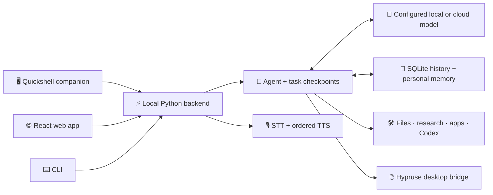

<div align="center">

# ⚡ THURSDAY

### Your desktop. Your tools. Your AI copilot.

**A JARVIS-inspired Linux companion that does the work where you can see it.**


**🖥️ Desktop actions · 🎙️ Voice · 🧠 Personal memory · 🔎 Research · 🛠️ Codex workspaces**

[🚀 Get started](#quick-start) · [✨ Explore features](#capabilities) · [🎬 Watch demos](#demos) · [🧩 Architecture](#architecture) · [📚 Guides](#-pick-your-next-page)

</div>

---

Thursday brings an AI assistant into the place you already work: your Linux desktop.
Find a file, control Spotify, inspect a window, research a topic, prepare an email draft,
or open a contained coding session without turning every task into a tour of different apps.

A local Python backend connects a configurable model to real tools. A native **Quickshell
companion**, a **React web app**, and a **CLI** share the same assistant. Tool results,
approvals, task controls, and recoverable checkpoints keep the work visible.

> **Local-first, not automatically offline.** Storage and the server are local. The default
> model, Google speech recognition, and Edge TTS use external services. A local LLM and optional
> Kokoro voice are separate choices. Review [privacy and data flow](docs/NATIVE_DESKTOP.md#privacy-and-data-flow)
> before sharing prompts, microphone audio, desktop captures, or personal context.

<a id="capabilities"></a>
## ✨ More than a chat window

| | Capability | What it brings to your day |
| :---: | --- | --- |
| 🖥️ | **Desktop awareness & control** | Hypruse observes the live session, targets specific windows, and uses accessible controls or transient captures when needed. |
| 📂 | **Files & terminal** | Indexed filename search, file operations inside configured roots, and guarded terminal commands. |
| 🔎 | **Research & visual reviews** | Search the web, fetch source material, inspect websites, and present grounded findings. |
| 🧠 | **Memory you can inspect** | Personal facts and preferences with provenance, correction, retrieval, and deletion controls. |
| ✉️ | **Everyday integrations** | Inbox summaries, unsent Gmail drafts, confirmed Calendar writes, and Spotify playback controls. |
| 🎙️ | **A voice in your desktop** | Push-to-talk, a non-focus-stealing HUD, ordered spoken replies, and interruption when a new voice request starts. |
| ⏯️ | **Work you can stop & resume** | Saved task outcomes, cooperative cancellation, resumable checkpoints, and approval recovery. |
| 🛠️ | **A doorway into Codex** | Refine a project brief and open a visible Kitty session in a contained project workspace. |

### 💬 Try asking

These are example requests, not a promise that every application or machine is supported.
Available tools depend on your configuration, signed-in services, and desktop session.

- **📂 “Find my networking PDF and open it.”** Search for the file without digging through folders.
- **🎵 “Play my playlist on Spotify.”** Use Spotify's own player instead of controlling an arbitrary media app.
- **🔎 “Research this topic and show me the sources.”** Bring the evidence into the conversation.
- **✉️ “Draft an email to my teammate, but don't send it.”** Prepare a message in the signed-in browser.
- **🧠 “Remember that I prefer short answers.”** Store a preference you can later correct or forget.
- **🛠️ “Help me turn this idea into a Codex project.”** Refine the brief and launch the coding workspace.

### 🎛️ Three ways to work

| Surface | Best for | What you get |
| --- | --- | --- |
| **🖥️ Native companion** | Staying in your desktop flow | Chat, microphone, voice HUD, approvals, Stop/Resume, and local voice settings |
| **🌐 Web app** | Seeing the full picture | History, structured tool results, task evidence, memory review, and Codex project controls at `http://127.0.0.1:5005` |
| **⌨️ CLI** | Terminal-first sessions | Conversation through the same tools and model configuration |

The native companion does not depend on the bar or a browser staying open. Closing chat leaves
the backend and keyboard service available. Typed native replies are silent by default.

### 🌱 Built from a local-first experiment

Thursday began as a local-only, JARVIS-style experiment with llama.cpp on personal hardware.
That idea still guides it: useful work inside your terminal, file manager, browser, and music
player, with visible actions and clear boundaries. Local and cloud models use the same agent,
tools, and local memory. The checked-in default is GPT-6 Luna through the Responses API;
local llama.cpp and other OpenAI-compatible providers remain configurable.

<a id="architecture"></a>
## 🧩 How Thursday works



**One backend owns the work.** Clients submit commands and observe the same task state. The
agent builds bounded context, discovers relevant tools, asks for approval when required, and
records observed outcomes. Stop interrupts cooperative work; it cannot undo an action already
completed. Detailed process ownership and data flow live in the [architecture guide](docs/ARCHITECTURE.md).

| Layer | Where to look |
| --- | --- |
| 🧭 Agent, tasks & checkpoints | [`assistant/agent/`](assistant/agent/) |
| 🧠 Personal memory | [`assistant/memory/`](assistant/memory/) |
| 🛠️ Tools & integrations | [`assistant/tools/`](assistant/tools/) · [`assistant/integrations/`](assistant/integrations/) |
| 🎙️ Speech pipeline | [`assistant/voice/`](assistant/voice/) |
| 🌐 React interface | [`assistant/web/`](assistant/web/) |
| 🖥️ Native QML companion | [`desktop/quickshell/`](desktop/quickshell/) |
| 📦 Contained Codex projects | [`codex_workspace/`](codex_workspace/) |

<a id="quick-start"></a>
## 🚀 Quick start

### 1 · Choose your setup

**Python 3.11+ is required.** Choose the native path for the supported Hyprland/Quickshell
layout, or start with CLI/web if you do not use that desktop. Native setup also installs user
services and desktop integration, so inspect the dry run before applying it.

| Path | Install | Requirements |
| --- | --- | --- |
| 🖥️ Native desktop | `.[hypruse,hotkeys,voice,desktop]` | Live Hyprland session, supported Quickshell layout, systemd user services, microphone/input access |
| 🌐 CLI / web | `.` | Python environment and a reachable configured model; set `THURSDAY_HYPRUSE=0` |
| 🧑‍💻 Contributor | `.[dev]` in addition to your chosen path | Python checks; Node.js/npm for the React app |

### 2 · Install the package

For the native desktop path:

```bash
git clone https://github.com/9MidhunPM/thursday-local-assistant.git Thursday
cd Thursday
python3 -m venv .venv
.venv/bin/python -m pip install -e '.[hypruse,hotkeys,voice,desktop]'
cp .env.example .env
chmod 600 .env
```

Run `cp` only for a new configuration; keep an existing `.env`. PyAudio requires the system's
PortAudio development support. The native integration also needs a running Hyprland session,
Quickshell with Qt Multimedia, systemd user services, and microphone access. Install `ffmpeg`
for speech normalization and measured waveforms, and PipeWire's `pw-dump` for output-route feedback.
See the [prerequisites](docs/NATIVE_DESKTOP.md#prerequisites) before installing desktop configuration.

For a CLI/web installation without Hyprland, use the base install **instead of** the desktop
extras in the command above:

```bash
.venv/bin/python -m pip install -e .
```

Set `THURSDAY_HYPRUSE=0` in `.env`. `run.sh` checks the existing environment; it never installs
dependencies. Optional voice and app integrations still need their own system prerequisites.

### 3 · Configure your model & voice

Edit the ignored `.env`:

```bash
LLM_PROVIDER=openai
LLM_MODEL=gpt-6-luna
LLM_API_MODE=auto
LLM_REASONING_EFFORT=low
OPENAI_API_KEY=your-api-key
THURSDAY_USER_NAME="Your name"
THURSDAY_TTS_ENGINE=online
THURSDAY_TTS_LOCAL_VOICE=bm_george
THURSDAY_TTS_SPEED=1.0
THURSDAY_TTS_VOICE=en-GB-RyanNeural
THURSDAY_TTS_RATE=+0%
```

The default speech engine uses Edge's British male `en-GB-RyanNeural`. Edge TTS 7.3.1 or newer
is required for the updated service handshake. An optional local Kokoro voice provides offline
synthesis and fallback when installed. Personal identity, voice, and
provider credentials belong in `.env`; the public configuration uses a generic user name.
The response style favors concise, natural confirmations and clear failures grounded in tool
results. `THURSDAY_SYSTEM_PROMPT` can override the base prompt; the shared expression guidance
is appended by the loader.

Install the optional local neural voice explicitly:

```bash
.venv/bin/python -m assistant.voice.neural_setup
```

This optional setup uses an isolated Python 3.13 environment and checksum-verified model/voice files in
private local storage. It does not require a paid speech API. See the
[voice setup and recovery guide](docs/NATIVE_DESKTOP.md#natural-voice) for dependencies and controls.

For local model inference, replace the provider values with:

```bash
LLM_PROVIDER=local
LLAMA_HOST=127.0.0.1
LLAMA_PORT=8080
MODEL_PATH=~/.models/your-model.gguf
LLAMA_SERVER_BIN=~/llama.cpp/build/bin/llama-server
```

Start the model separately with `./run_vulkan_server.sh` or your existing llama.cpp service.
Choosing a local model does not change the configured STT/TTS providers. For another compatible
API, use `LLM_PROVIDER=custom`, `LLM_BASE_URL`, `LLM_MODEL`, and `LLM_API_KEY`.

### 4 · Install the native companion (desktop path)

Run from your graphical session:

```bash
.venv/bin/python -m assistant.desktop_install install --dry-run
.venv/bin/python -m assistant.desktop_install install
.venv/bin/python -m assistant.desktop_install doctor
```

The installer targets the supported existing Hyprland Lua and Quickshell layout. It refuses
unknown or conflicting layouts instead of replacing the desktop configuration. It backs up
managed files privately, installs one root-level companion, and enables `thursday.service`
and `thursday-hotkeys.service`. [Installation, recovery, and rollback](docs/NATIVE_DESKTOP.md)
cover the exact layout, service commands, and safe uninstall procedure.

| Shortcut | Action |
| --- | --- |
| **Super + C** | Toggle native chat |
| **Alt + Space** | Toggle native chat; focus the composer when opening |
| **Super + Alt**, held | Record; release to transcribe and submit |

A recording stops automatically after 55 seconds. The HUD does not take keyboard focus.
Closing chat keeps the server and keyboard service available. Open the settings menu for
**Voice on/off**, **Speak typed replies**, **Motion on/off**, and **Full app**.
The header's **Web app** button and the application menu's **Thursday Web** entry open
the detailed interface. Repeated launches focus its existing dedicated window.

### 5 · Launch your preferred surface

```bash
./run.sh                         # CLI with local HTTP server
./run.sh --web                   # Web app
./run.sh --web --no-browser      # Foreground server without opening a browser
./run_web.sh                     # Open/reuse the web app through the installed service
./run_with_llm.sh                # Start the installed service and toggle native chat
./run_hotkeys.sh                 # Start the installed supervised hotkey service
```

The two desktop wrappers require the native installation. They do not create a second daemon
or stop the server when a window closes. For an installed desktop, manage the backend with
`systemctl --user restart thursday.service` rather than running a second foreground server.

## ⚙️ Configuration & action boundaries

| Setting | Location / behavior |
| --- | --- |
| Model, endpoint, provider keys | `.env`; see `.env.example` |
| Name and spoken voice | `THURSDAY_USER_NAME`, `THURSDAY_TTS_ENGINE`, `THURSDAY_TTS_LOCAL_VOICE`, `THURSDAY_TTS_SPEED`; Edge voice/rate when selected |
| Native preferences | Local `~/.config/thursday/native.json`, respecting `XDG_CONFIG_HOME` |
| Desktop bridge | `THURSDAY_HYPRUSE=1`; requires the optional packages and live session access |
| Task budget | `THURSDAY_MAX_TOOL_STEPS=24`, `THURSDAY_TASK_TIMEOUT=300` |
| Request context | `LLM_CONTEXT_BUDGET=24000`; image accounting is approximate |
| HTTP listener | `THURSDAY_HOST=127.0.0.1`, `THURSDAY_PORT=5005` |
| API authentication | Optional `THURSDAY_API_TOKEN`; native headers and a browser connection prompt |
| Tool roots, shell policy, STT | `assistant/config/config.json` and supported environment overrides |

The checked-in desktop profile allows shell access and broad reads. For a shared machine,
start from `assistant/config/config.safe.example.json` and explicitly choose permissions.
Read/write roots, shell policy, observed desktop targets, and action confirmations are separate
controls; a tool result must support any completion claim.

To use the safer profile in a foreground session, stop any installed backend first, then run:

```bash
./run.sh --config assistant/config/config.safe.example.json --web
```

The file's defaults disable shell execution and Hypruse, restrict writes to the checkout, and select
local inference. Reads still include your home directory. The checkout's `.env` and exported
environment variables override the selected file, including `LLM_PROVIDER`, `LLM_MODEL`,
`LLM_BASE_URL`, `THURSDAY_ALLOW_SHELL`, `THURSDAY_HYPRUSE`, and the path settings. Review those
values before starting; `--config` does not change the installed service's configuration.

Keep the service on loopback. Non-loopback binding requires `THURSDAY_ALLOW_REMOTE=1`; configure
a token before deliberately exposing it. The native transport only accepts loopback addresses.
When a token is configured, the web app asks for it and exchanges the header credential for a
one-hour HttpOnly, SameSite=Strict session cookie. It does not save the token in URLs or browser
storage. Never put credentials in public configuration.

Memory and conversation history remain on disk until removed through their respective controls.
Generated audio and captures are transient; logs, recordings, local configuration, backups,
screenshots, and personal workspace artifacts must stay out of commits. Git ignore rules are a
convenience, not a substitute for reviewing each staged change.

## 🔌 Connect your everyday tools

Gmail, Calendar, and Instagram use the managed Thursday Brave Helper in the normal signed-in
profile. Install and inspect it explicitly:

```bash
.venv/bin/python -m assistant.integrations.brave_helper --install
.venv/bin/python -m assistant.integrations.brave_helper --status
.venv/bin/python -m assistant.integrations.mailto_handler --install
```

The native launcher does not install browser policies. Gmail drafting leaves the message unsent;
Calendar writes show a confirmation. Spotify tools select Spotify's own MPRIS player. File
search uses `plocate`; the installed desktop applications and their accessibility support affect
which integrations are available.

YouTube searches return results without opening tabs. Requests to open a channel use a matching
result and one explicit `open_url` action; repeated dispatches of the same URL within a task
reuse its recorded outcome. Slow preferred search providers have bounded attempts before the
public fallback. A browser launch result confirms dispatch, not that the page finished loading.

In the web app, **Codex Project** accepts a lowercase, hyphenated workspace name, a brief, and an
optional model identifier. **Refine with Thursday** asks for material missing details;
**Open Codex in Kitty** launches the contained interactive session. The visible terminal is the
source of truth for completion. See the [workspace guide](codex_workspace/README.md).

## 🧪 Development & verification

```bash
.venv/bin/python -m pip install -e '.[dev]'
.venv/bin/python -m pytest assistant/tests -q
.venv/bin/python -m ruff check assistant --select E9,F63,F7,F82
cd assistant/web
npm ci
npx tsc --noEmit
npm run build
npm audit
```

Integration checks on **2026-10-20** passed **429 Python tests**, with one known `aifc`
deprecation warning from a dependency. Python error lint, TypeScript checks, the Vite 7.3.7
production build, and Qt6 QML lint passed; the npm audit reported zero vulnerabilities.
The graphical-session doctor also reported both services active and enabled with zero restarts
and no problems. These checks cover controlled fixtures and service readiness;
they do not establish successful microphone transcription or spoken playback on every machine.
The [native acceptance scenarios](docs/NATIVE_DESKTOP.md#acceptance-scenarios) keep service
readiness, rendered interaction, speech, and real desktop execution separate.

List model evaluation cases without making paid requests:

```bash
.venv/bin/python -m assistant.evals.copilot
```

The retained [Luna comparison](docs/COPILOT.md#luna-comparison) describes a dated, synthetic
24-case evaluation. `--live` deliberately makes provider requests. It is not a guarantee of
unattended desktop reliability.

<a id="demos"></a>
## 🎬 Watch Thursday in action

- [Files, Gmail drafts, and Calendar](https://drive.google.com/file/d/1VBo7DjoN34oAEptECPhUGLXbTuoWGxJp/view?usp=drive_link)
- [System status and Spotify](https://drive.google.com/file/d/13Sw3TUYcaSJo1eIMX1XZZqWVLdZNHmjq/view?usp=drive_link)
- [Native desktop integration](https://drive.google.com/file/d/1Wd_5lowulWIXl_skxhNKPAqPBthTayDT/view?usp=drive_link)
- [Complete collection](https://drive.google.com/drive/folders/1s2c5p86JadB3azm1t-a7LQFfNALwEmIG?usp=sharing)

These recordings show earlier versions; current native controls and lifecycle are documented
above. The [demo guide](docs/DEMO.md) contains workflow prompts. The repository also includes
[Ritual](codex_workspace/todo-app/README.md), a local habit-tracker demo produced through Codex.

## 🧭 What works today, and what comes next

Thursday is a hands-on desktop assistant, not a guarantee of unattended execution. Keep these
distinctions in mind when trying it or building on it:

| ✅ Available now | 🚧 Still on the roadmap |
| --- | --- |
| Personal facts, preferences, correction and deletion | Document ingestion with source citations |
| Durable task checkpoints and Stop/Resume | Durable scheduled reminders |
| Interactive tools and confirmed actions | Reviewed, reusable routines |
| Contained Codex launch in a visible terminal | Codex job completion tracking |

A Codex launch confirms that a session opened, not that its project is finished. Filename search
is not a semantic index of every document. Current tool selection starts with keyword groups
and discovery; more capable routing needs measured evaluation. See [next work](docs/COPILOT.md#rollback-and-next-work)
for the existing roadmap rather than treating planned features as shipped.

## 🩺 Quick troubleshooting

| Symptom | First thing to check |
| --- | --- |
| Native chat or shortcuts do not respond | Run `.venv/bin/python -m assistant.desktop_install doctor`; verify the supported desktop layout and both user services. |
| Microphone recording or transcription fails | Check microphone access, PyAudio/PortAudio, and the configured STT service. Service readiness alone does not prove microphone capture works. |
| Speech fails or sounds wrong | Review the selected TTS engine and dependencies. Edge needs network access; local Kokoro must be installed explicitly. |
| Backend appears to start twice | On an installed desktop, use `systemctl --user restart thursday.service`, not another foreground server. |
| Local model does not respond | Start llama.cpp separately and check the configured host, port, model path, and server binary. |
| Gmail or Calendar is unavailable | Inspect the managed Brave Helper and the signed-in browser profile. Installing the companion does not install browser policies. |
| A task pauses or is interrupted | Review its evidence and checkpoint in the web app before resuming. Completed actions are not rolled back by Stop. |

For recovery and uninstall, use the [native desktop guide](docs/NATIVE_DESKTOP.md), which explains
managed-file backups and conflict handling. Avoid deleting runtime databases as a shortcut.

## 📚 Pick your next page

| Guide | Start here when you want to… |
| --- | --- |
| [🖥️ Native desktop](docs/NATIVE_DESKTOP.md) | Install, diagnose, configure voice, or safely roll back the companion |
| [🧩 Architecture](docs/ARCHITECTURE.md) | Understand processes, request flow, tools, storage, and trust boundaries |
| [🧠 Copilot behavior](docs/COPILOT.md) | Understand routing, memory, task recovery, evaluation, and limitations |
| [🎬 Demo guide](docs/DEMO.md) | Try workflows and prepare a demonstration |
| [🛠️ Codex workspace](codex_workspace/README.md) | Understand the contained project-launch workflow |
| [⚙️ Environment template](.env.example) | Find model, voice, server, and integration settings |
| [🛡️ Safer profile](assistant/config/config.safe.example.json) | Start with shell and desktop automation disabled, then review overrides |

### 🤝 Contributing thoughtfully

Keep changes focused, add regression coverage for behavior changes, and run the checks above.
Describe what you actually verified, especially for desktop, audio, and provider-dependent flows.
Never commit keys, private configuration, recordings, captures, memory databases, or personal
workspace artifacts. For UI or workflow proposals, distinguish the current behavior from the
intended improvement and include reproduction steps.

## 📄 License

No license file is currently included in this repository. Do not assume an open-source license
or unrestricted reuse rights; a license must be added by the project owner to define them.
