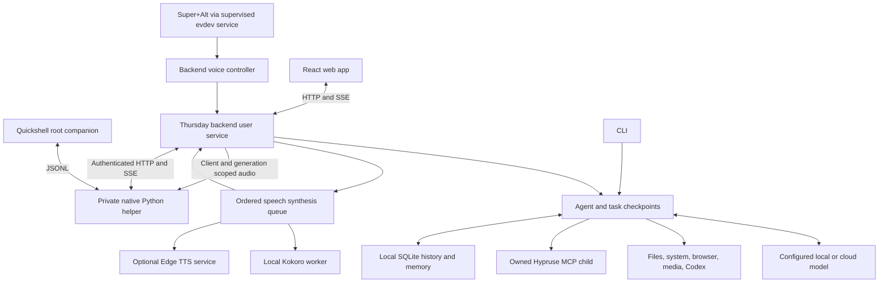

# Architecture and internals

Thursday is a single-user Linux desktop agent. One backend owns conversations, tasks, tools, and
voice capture. The native companion and web app observe that state and submit explicit commands.
The model chooses capabilities; Python tools execute them and report evidence.

## System map



The default cloud model, Google STT, and Edge TTS are independent network dependencies. Edge
sends response text to its service; optional Kokoro synthesis stays local. A local
server or SQLite database does not imply that prompts and microphone audio remain on the
machine. [Data handling](NATIVE_DESKTOP.md#privacy-and-data-flow) describes each boundary.

## Process and interface ownership

- `thursday.service` runs the backend in the checkout's virtual environment. Its user-service
  lifecycle is independent of chat/window visibility.
- `thursday-hotkeys.service` owns evdev input forwarding. It sends start/stop/cancel commands to
  the backend; it does not own a second recorder or transcript overlay.
- `desktop/quickshell/Thursday.qml` is instantiated once at the shell root, outside per-monitor
  bar variants. It owns one chat/HUD state model and one audio queue. The bar button calls IPC.
- `assistant/native_client.py` is the companion's child transport. It loads private configuration,
  sends token headers, reconstructs complete SSE records, reconnects, and downloads audio into
  private runtime files. Credentials never cross its JSONL boundary into QML.
- The React app provides detailed conversation history, tool results, task evidence, memory
  review, and Codex controls. The legacy HTML fallback is a basic compatibility surface.
- `assistant/web_launch.py` starts the supervised backend when requested and opens or focuses
  its dedicated Brave app window. An origin-specific lock prevents concurrent launches from
  creating duplicate windows; focus failures preserve the existing window and report an error.
- `assistant/desktop_install.py` installs the supported existing Hyprland Lua/Quickshell layout
  using an allowlist, private backups, and managed-file hashes. Unsupported layouts and conflicting
  edits are rejected. Uninstall preserves the complete installation when a conflict needs review.

The session wrapper imports the live display, runtime, compositor, and session-bus variables into
the user service manager. Services restart after failures within bounded systemd limits; missing
optional dependencies can exit with a stable diagnostic instead of an endless restart loop.
`run.sh` checks dependencies without installing them. The desktop wrappers start the installed
services and request native IPC; closing chat never shuts down the backend.

## Request and task lifecycle

1. Native chat, the web app, or the shared voice controller submits a turn. The HTTP server checks
   the busy lock before activating a conversation, creates a durable task, and publishes IDs.
2. The agent builds bounded context from the conversation, relevant memories, and system prompt.
   Initial tool groups reduce the catalog; `discover_tools` adds capabilities when needed.
3. OpenAI uses stateless Responses with reasoning-item replay; compatible/local endpoints use
   their configured transport. Only parsed, schema-valid calls reach execution.
4. Path, shell, desktop target, and approval rules are checked. Independent safe reads may run
   together; desktop mutations and mixed action batches remain ordered.
5. SSE carries tokens, tool activity/results, approvals, voice state, and task updates. Native text
   is rendered as plain text. The native view preserves unsent drafts and rejects stale history
   snapshots when another surface changes the shared active conversation.
6. Delivered outcomes are checkpointed. Stop cooperatively cancels future work and owned model/
   desktop activity. Resume creates a child task with prior outcomes; it cannot undo delivered
   actions. A backend restart marks unfinished runs interrupted.
7. A bounded extraction queue stores personal facts only from literal user evidence, retaining
   provenance separately from temporary model context.

Approvals are recovered through `init.pending_confirms` after reconnect. The backend rejects
expired requests and publishes their resolution. After approval, the desktop adapter observes
again, revalidates the target, and delivers once. A finished response is not a universal guarantee
that every requested real-world effect was verified.

## Voice and playback

`assistant/voice/controller.py` owns one microphone session with an ID. Audio remains in memory,
recording stops after 55 seconds, and release starts transcription. Cancelling or starting another
session invalidates older work, so a late transcript cannot submit an obsolete request. Hotkeys
and the native microphone button use this same controller.

The native view treats ordered `voice_state` events and reconnect snapshots as authoritative.
HTTP acknowledgements do not overwrite newer state. Listening/transcribing both expose Cancel
voice; tasks expose Stop and resumable checkpoints. The HUD does not take keyboard focus.

TTS synthesis uses an ordered queue with generation invalidation. Audio events identify their
client, generation, sequence, and task. The requesting native or web surface owns playback;
opening a browser does not take ownership of native speech. The native helper authenticates each
audio fetch, gives QML a private file URL, and deletes its copy after playback or expiry. Playback
feedback distinguishes synthesis from actual playing/idle/failed state. Late audio from interrupted
generations is discarded.

The native helper decodes bounded PCM envelopes with `ffmpeg`. The visualizer samples them at
Qt's current playback position, retaining zero for silence. While native speech files exist,
one bounded `pw-dump --monitor` child observes Quickshell's own stream, active output links,
and stream/sink gain. Only filtered readiness and ownership IDs enter QML. Speaking feedback
requires actual playback and an observed usable route; this does not establish physical acoustic
output. The observer stops when the last owned file is released or the helper closes.

Native typed replies are silent unless the local `speak_typed` preference is enabled. Native mute
suppresses playback; reduced motion affects visual feedback. Personal voice identity/rate come
from environment overrides. Provider failures are errors, never transcription text sent to the agent.

## Capability and storage boundaries

Built-in tools are discovered through `assistant/tools/registry.py`. Each declares a function
schema and implements deterministic execution. Native integrations use Linux interfaces such as
MPRIS, Hyprland IPC, Thunar, and indexed filename search. The managed Brave Helper uses the normal
signed-in browser profile; Gmail drafts remain unsent and Calendar writes require confirmation.

`youtube_search` returns channel/video evidence without opening a browser. `open_url` validates
HTTP(S) targets and records dispatch outcomes in a task-local ledger shared across tool
instances. Repeated requests for that URL reuse the recorded dispatched/uncertain outcome;
they cannot open another tab to verify loading. Search provider attempts have separate bounded
deadlines so an unresponsive preferred service yields to the public fallback promptly.

The Hypruse adapter owns a lazy stdio MCP child in the same virtual environment. It checks packages
and graphical session access, registers live schemas under `hypruse__`, and exposes sanitized
readiness details. Window addresses, accessibility names, and screenshot geometry ground actions.
Strict seat and authentication guards remain enabled. Screenshots are task-driven rather than
continuous monitoring; bounded preview IDs expire, and raw images stay out of SQLite/model logs.

Conversation history, task checkpoints, personal assertions, and named memories share local SQLite
storage. Corrections retain supersession history; forgetting invalidates queued extraction.
Forgetting personal memory and deleting conversation history are separate operations.

Codex launch envelopes are parsed locally. The orchestrator validates a contained workspace,
strips Thursday's provider credentials from the child environment, and opens a visible Kitty
session with workspace-write restrictions. The interactive terminal remains the authority for
completion; Thursday confirms only the observed launch.

## Privacy and publication

The server binds to loopback by default; remote exposure requires explicit opt-in and should use
API authentication. Configured token checks apply to API routes. The native helper accepts only
loopback URLs, authenticates in headers, disables proxy inheritance and redirects, and never
writes tokens into QML, process arguments, or query strings.

The React connection gate exchanges the configured operator token in an authorization header
for a signed one-hour session cookie. It is HttpOnly, SameSite=Strict, and scoped to `/api`; the
operator token is not saved in browser storage. Renewal requires the operator token again.
Cross-origin mutation checks remain separate from authentication.

`assistant.paths` supplies user-owned `0700` runtime directories and atomic `0600` files. Transient
speech and captures are separated from persistent conversation storage. The installer tightens
local `.env`, database, and log permissions and keeps its backups outside the repository. Public
configuration uses generic identity defaults; credentials and personal overrides live locally.

Logs and diagnostics minimize private content, but local logs, environment files, databases,
recordings, screenshots, and installation backups remain private artifacts. Publishing uses explicit
staging and content review. Ignore rules do not retroactively sanitize existing Git history.

## Verification and extension points

```bash
.venv/bin/python -m pytest assistant/tests -q
.venv/bin/python -m ruff check assistant --select E9,F63,F7,F82
/usr/lib/qt6/bin/qmllint desktop/quickshell/Thursday.qml desktop/quickshell/NativeButton.qml
cd assistant/web
npm ci
npx tsc --noEmit
npm run build
```

The Qt6 `qmllint` path is distribution-specific. Controlled tests cover transport framing/auth,
voice ownership, cancellation, approval expiry, replay, private files, installer conflicts, and
rollback. Rendered native behavior, physical microphone/STT/TTS, provider access, and a real
Hypruse task require separate live evidence; use the [acceptance scenarios](NATIVE_DESKTOP.md#acceptance-scenarios).

To add a capability, declare its schema/group and narrow execution interface, apply the appropriate
path/approval/desktop safeguards, and test success, rejection, and interruption. Keep new transient
artifacts in private runtime storage and preserve task/conversation/client IDs across UI boundaries.
